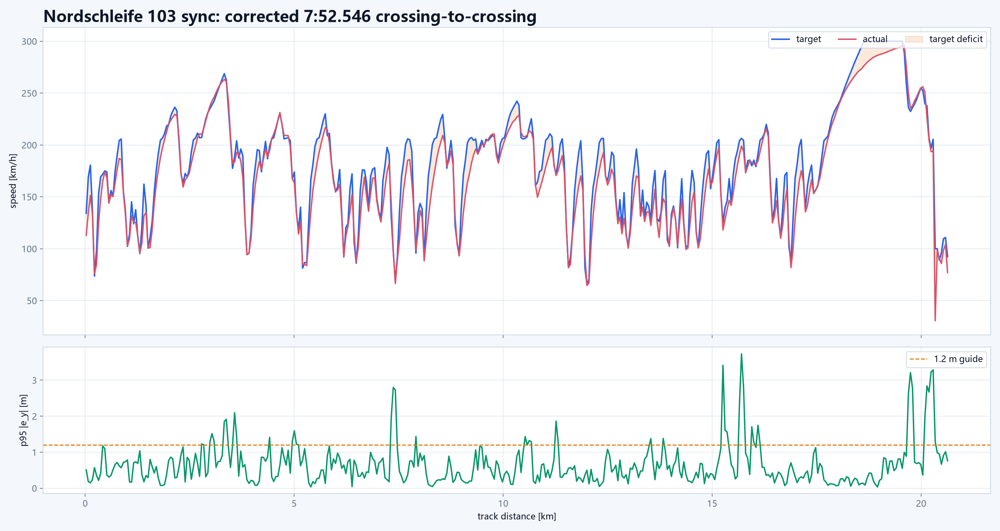

# Verified results

All lap times below are derived from complete laps in the original CSV logs.
The public repository excludes the raw logs because they are large, but every
number has a corresponding source path in `configs/final/manifest.json`.

```text
Vehicle: BMW M4 Competition (G82)
Tyres:   Michelin PS4 Cup 2
```

## Summary

| Track | Human teaching lap | Best automatic lap | Gap | Automatic max speed | Tyres out | Status |
| --- | ---: | ---: | ---: | ---: | ---: | --- |
| Shanghai | 136.248 s | 134.399 s | -1.849 s | 300 km/h cap | 1 | local-line60 candidate |
| Zhejiang | 94.329 s | 96.245 s | +1.917 s | 280 km/h cap | 2 | local055 user-confirmed candidate |
| Nordschleife | 7:17.632 | 7:52.546 | +34.914 s | 300 km/h cap | 2 | corrected crossing-to-crossing result |


## Latest configuration decisions

All three current candidates share:

- Frenet lateral MPC with the final 103 weights.
- Measured acceleration capability from the P90 envelope.
- Planning braking separated from the command brake limit.
- `target_fall_kmh_s=188`.
- Longitudinal MPC `q_speed=30`, `r_accel=0.30`, `r_jerk=20`.

Lateral weights:

```text
q_lateral = 11.5
q_heading = 135.0
q_lateral_velocity = 3.5
q_yaw_rate = 28.0
r_steer = 15.0
rd_steer = 700.0
```

The planning brake boundary is capped at the smaller of the configured limit
and the measured capability envelope. Control requests may exceed that value,
which is what finally produced full brake-pedal usage.

## Shanghai

The latest crossing-based automatic lap is `134.399 s`:

- config `configs/final/shanghai_frenet_local_line60_perfect.json`
- run record `configs/final/shanghai_frenet_local_line60_perfect_run.json`
- line offsets `configs/line_offsets/shanghai_local_two_corners.json`
- local speed envelope `configs/speed_envelopes/shanghai_local_60s.json`
- maximum-speed cap `300 km/h`
- p95 lateral error `1.923 m`
- p95 heading error `0.0796 rad`
- maximum tyres out `1`

The run updates the previous V63 verification result of `143.543 s`. The main
gain came from the lateral-weight refinement, full brake authority and two
small track-local corrections rather than a global speed-scale increase.

The Shanghai human-versus-auto comparison shows:

- The automatic car is consistently close to the human on long straights.
- The largest deficits occur in corner entry and exit speed, around
  `1.45-1.50 km`, `2.95-3.05 km`, and `4.60-4.70 km`.
- The human reaches higher peak lateral acceleration in several corners,
  especially around `0.7-0.9 km` and `4.9-5.1 km`.
- The automatic controller is smoother in yaw rate and avoids abrupt steering
  reversals.

## Zhejiang

The latest crossing-based automatic lap is `96.245 s`:

- config `configs/final/zhejiang_frenet_local055_perfect.json`
- run record `configs/final/zhejiang_frenet_local055_perfect_run.json`
- local speed envelope `configs/speed_envelopes/zhejiang_local_055.json`
- p95 lateral error `1.532 m`
- p95 heading error `0.104 rad`
- maximum tyres out `2`

The lateral-weight refinement reduced yaw-error P95 from `0.2672` to
`0.1896 rad/s`, heading-error P95 from `0.1202` to `0.1040 rad`, and mean raw
steering movement from `0.002993` to `0.001963`. The confirmed 103 candidate
completed three repeated laps at `101.172`, `101.094` and `101.062 s` before
the local055 speed-envelope version was retained.

The Zhejiang comparison shows:

- The automatic car is about `10.2 km/h` slower on average over the lap.
- Most of the gap comes from lower mid-corner and corner-exit speed.
- The human uses roughly `1.1-1.5 g` in several corners where the automatic
  controller remains closer to `0.8-1.1 g`.
- The automatic controller is repeatable, with four laps separated by only
  about `27 ms`.

## Nordschleife

The current synchronized configuration completed a corrected
crossing-to-crossing lap of `472.546 s`, about `7:52.546`:

- config `configs/final/nordschleife_frenet_refine_103_sync.json`
- launcher `tools/start_nordschleife_refine_103_sync.ps1`
- first line crossing at `15.341 s` after controller start
- finish crossing at `487.887 s` after controller start
- corrected lap interval `472.546 s`
- maximum tyres out `2`
- p95 lateral error `1.185 m`
- p95 heading error `0.0636 rad`

The earlier `487.891 s` log value included the pre-line segment and must not be
used as the lap time. A pending candidate v2 is saved in
`configs/final/nordschleife_frenet_refine_103_candidate_v2.json` for two
track-local corrections identified from the recorded lap.

The remaining bottleneck is longitudinal execution, not lateral stability.
High-speed speed deficits reached `50-87 km/h` at p95 in the main speed bands.
The most visible case is `480-490 s`, where the target was `300 km/h`, the
actual speed was about `254 km/h`, and throttle was already saturated.



## Interpretation

The project demonstrated:

- Stable closed-loop control at 50 Hz.
- A complete Nordschleife lap with no tyre exit.
- Repeatable laps on Shanghai and Zhejiang.
- Good path tracking with p95 lateral error between `0.46 m` and `0.57 m`
  on the verified runs.

The main performance gap against the human lap is not basic path following.
It is the use of available lateral grip and the ability to convert that grip
into earlier throttle and higher corner-exit speed.
